# Activité Pratique : Platform Engineering avec Backstage

### Industrialisation du cycle de vie d'un Portfolio Next.js

| | |
|---|---|
| **Formateur** | Wahid Hamdi |
| **Étudiante** | Wissal Elkouk |
| **Dépôt de la plateforme (rendu)** | https://github.com/wissalElkouk-org/backstage-platform |
| **Dépôt généré par Backstage** | https://github.com/wissalElkouk-org/portfolio-nextjs |
| **Image Docker Hub** | https://hub.docker.com/r/wissalelkouk/portfolio-nextjs |
| **Date** | Novembre 2026 |

---

## État d'avancement par rapport au sujet

| Étape du sujet | Résultat | Preuve |
|---|---|---|
| 1. Projet Next.js créé par un Software Template | Réalisé | Captures 01, 02 |
| 1. Composant enregistré dans le Catalog | Réalisé | Capture 03 |
| 2. Dépôt GitHub créé et initialisé automatiquement | Réalisé | Capture 02 |
| 3. Dockerfile, `.dockerignore`, `docker-compose.yml` générés et versionnés | Réalisé | Dépôt généré |
| 4. Build de l'image et version `v<N>` | Réalisé | Captures 05, 11 |
| 4. Statut du build visible dans Backstage | Réalisé (plugin GitHub Actions) | Capture 03 |
| 5. Publication sur Docker Hub | Réalisé | Capture 08 |
| 6. Déploiement local, URL affichée | Réalisé | Captures 02, 15 |
| 7. Évolution (Certifications, Projets, Dark Mode) depuis Backstage | Réalisé | Captures 09 à 14 |
| 7. Relance automatique de toute la chaîne après modification | Réalisé (merge de la Pull Request) | Capture 11 |
| 7. Relance sans modification (template dédié) | Réalisé | Captures 16, 17 |

Écarts à signaler honnêtement :

- le **merge de la Pull Request** se fait par un clic sur GitHub, pas dans Backstage ;
- le premier run du dépôt généré a échoué (identifiants Docker Hub saisis dans le mauvais champ du formulaire) et a été relancé après correction des secrets ; la section 11 détaille la cause et la correction ;
- la connexion OAuth GitHub de l'onglet CI/CD de Backstage a nécessité une OAuth App ; le statut des builds est aussi accessible par les liens de la sortie du template.

---

## 1. Objectif et résultat

| # | Exigence du sujet | Réalisation |
|---|---|---|
| 1 | Créer un projet Portfolio Next.js | Template `portfolio-nextjs-template` (étape `fetch:template`) |
| 2 | Créer le dépôt Git | Action `publish:github`, dépôt `portfolio-nextjs` dans l'organisation GitHub |
| 3 | Générer les artefacts Docker | `Dockerfile`, `.dockerignore`, `docker-compose.yml` versionnés dans le dépôt généré |
| 4 | Construire l'image | Job `build-and-push` (GitHub Actions) |
| 5 | Publier sur Docker Hub | Même job, tags `v<run_number>` et `latest` |
| 6 | Déployer localement | Job `deploy-local` sur un runner self-hosted, `docker compose up -d` |
| 7 | Faire évoluer et relivrer | Templates `portfolio-evolve-template` et `portfolio-redeploy-template` |

Résultat vérifié : application accessible sur le port 3000 de la machine, image `wissalelkouk/portfolio-nextjs:v3` en bonne santé (`healthy`).

## 2. Architecture

```
Développeur
    │
    ▼
Backstage (http://localhost:3001, backend :7007)
 ├─ Template portfolio-nextjs-template   → génère code + Docker + workflow, crée le dépôt GitHub,
 │                                         pose les secrets, enregistre le composant dans le Catalog
 ├─ Template portfolio-evolve-template   → ouvre une Pull Request (Certifications, Projets, Dark Mode)
 └─ Template portfolio-redeploy-template → déclenche le workflow (github:actions:dispatch)
    │
    ▼
GitHub (organisation wissalElkouk-org, dépôt portfolio-nextjs)
 └─ GitHub Actions : .github/workflows/ci-cd.yml
      ├─ build-and-push  (ubuntu-latest)        : build Next.js → image Docker → push Docker Hub
      └─ deploy-local    (runner self-hosted)   : docker compose pull/up → contrôle de santé
    │
    ▼
Docker Hub : <user>/portfolio-nextjs:v1, v2, v3 … et latest
    │
    ▼
Machine locale : conteneur « portfolio » sur http://localhost:3000
```

Un dépôt GitHub ne peut piloter le Docker d'une machine locale que par un **runner self-hosted**. Il est enregistré sur l'organisation avec le label `local`, que le workflow cible par `runs-on: [self-hosted, local]`.

## 3. Prérequis

| Élément | Version / remarque |
|---|---|
| Ubuntu 24.04 (VM ou machine physique) | 4 Go de RAM recommandés (2,8 Go + swap de 6 Go ont fonctionné, lentement) |
| Node.js | 24.15.0 ou plus récent (exigé par `@backstage/create-app` 0.9.x) |
| Yarn | 4.9.2 (voir section 11) |
| Docker Engine + Compose | Docker 29.x, Compose v5.x |
| Compte GitHub + organisation | Organisation gratuite pour héberger le dépôt et le runner |
| Compte Docker Hub | Token d'accès en lecture/écriture |
| Token GitHub (classic) | Scopes `repo` et `workflow` |

## 4. Installation de Backstage

```bash
# Node 24 via nvm
curl -o- https://raw.githubusercontent.com/nvm-sh/nvm/v0.40.3/install.sh | bash
source ~/.bashrc
nvm install 24 && nvm use 24

# Création de l'application
cd ~
npx @backstage/create-app@latest      # nom : backstage
cd backstage
```

Si `yarn install` échoue (bug Yarn 4.13 avec Node 24), appliquer le correctif de la section 11, puis :

```bash
yarn install
yarn --cwd packages/app add @backstage-community/plugin-github-actions
```

Le module `@backstage/plugin-scaffolder-backend-module-github` est déjà enregistré dans `packages/backend/src/index.ts`. Il fournit `publish:github`, `publish:github:pull-request` et `github:actions:dispatch`.

## 5. Configuration

Fichier `app-config.local.yaml` à la racine de `backstage/` (**non versionné**) :

```yaml
app:
  baseUrl: http://localhost:3001
backend:
  baseUrl: http://localhost:7007
  listen:
    host: 0.0.0.0
  cors:
    origin: http://localhost:3001

integrations:
  github:
    - host: github.com
      token: ${GITHUB_TOKEN}

catalog:
  rules:
    - allow: [Component, System, API, Resource, Location, Template, User, Group]
  locations:
    - type: file
      target: /home/<utilisateur>/backstage/templates/portfolio-nextjs-template/template.yaml
    - type: file
      target: /home/<utilisateur>/backstage/templates/portfolio-evolve-template/template.yaml
    - type: file
      target: /home/<utilisateur>/backstage/templates/portfolio-redeploy-template/template.yaml
```

Le token n'est jamais écrit dans un fichier du dépôt. Il est fourni par variable d'environnement :

```bash
read -s -p "Token GitHub: " GITHUB_TOKEN; echo
export GITHUB_TOKEN
```

Choix de conception : le port **3001** est réservé à l'interface Backstage afin de laisser le **3000** au portfolio, comme l'exige le sujet. L'interface est consultée via `localhost` (ou un tunnel SSH), car `crypto.randomUUID` n'existe pas en HTTP sur une adresse IP.

Lancement :

```bash
cd ~/backstage
export NODE_OPTIONS="--max-old-space-size=2048"
yarn start
```

Attendre `Plugin initialization complete`, puis ouvrir `http://localhost:3001/create`. Le catalogue utilise SQLite en mémoire : il est rechargé depuis les fichiers à chaque redémarrage, et tout fichier modifié dans le dossier provoque ce redémarrage.

## 6. Runner self-hosted

Sur GitHub : organisation → Settings → Actions → Runners → New self-hosted runner (Linux x64).

```bash
mkdir -p ~/actions-runner && cd ~/actions-runner
# commandes curl et tar affichées par GitHub
read -s -p "Token runner: " RTOKEN; echo
./config.sh --url https://github.com/<ORGANISATION> --token "$RTOKEN" --labels local --unattended --replace
unset RTOKEN
sudo ./svc.sh install
sudo ./svc.sh start
```

Points de contrôle :

- le runner apparaît **Idle** avec les labels `self-hosted`, `Linux`, `X64`, `local` ;
- dans Runner groups → Default, **Allow public repositories** est coché (le dépôt est public) ;
- l'utilisateur du runner appartient au groupe `docker` (`docker ps` sans `sudo`) ;
- le port 3000 de la machine est libre.

## 7. Les templates

Arborescence dans `templates/` :

```
portfolio-nextjs-template/
├── template.yaml
├── skeleton/                  # fichiers rendus (Nunjucks)
│   ├── package.json  next.config.js  README.md  catalog-info.yaml
│   ├── Dockerfile  .dockerignore  docker-compose.yml
│   ├── app/{layout.js,page.js,globals.css,api/health/route.js}
│   └── public/.gitkeep
└── workflow/.github/workflows/ci-cd.yml   # copié SANS rendu (fetch:plain)
portfolio-evolve-template/
├── template.yaml
└── content/app/{page.js,ThemeToggle.js,globals.css}
portfolio-redeploy-template/
└── template.yaml
```

### 7.1 `portfolio-nextjs-template` (étapes 1 à 3)

Paramètres : nom du composant, nom complet, titre, email, utilisateur Docker Hub, token Docker Hub (champ `Secret`), emplacement du dépôt (`RepoUrlPicker`).

| Étape | Action | Rôle |
|---|---|---|
| `fetch` | `fetch:template` | Génère le projet Next.js et les artefacts Docker à partir de `skeleton/` |
| `fetch-workflow` | `fetch:plain` | Ajoute `ci-cd.yml` sans interpréter les expressions `${{ }}` |
| `publish` | `publish:github` | Crée le dépôt, pousse le code, pose les secrets `DOCKERHUB_USERNAME` et `DOCKERHUB_TOKEN` |
| `register` | `catalog:register` | Enregistre `catalog-info.yaml` dans le Catalog |

Fichier `catalog-info.yaml` généré : annotation `github.com/project-slug` (nécessaire au suivi des builds), liens vers Docker Hub, l'application locale et GitHub Actions.

### 7.2 `portfolio-evolve-template` (étape 7)

Ouvre une Pull Request (`publish:github:pull-request`, branche `feature/v2-evolution`) qui remplace `app/page.js` et `app/globals.css` et ajoute `app/ThemeToggle.js` :

- section **Certifications** ;
- section **Projets DevOps & Cloud** ;
- **mode sombre** (variable CSS + bascule persistée dans `localStorage`) ;
- mise à jour du nom, du titre et de l'email.

Le **merge** de la Pull Request sur `main` déclenche automatiquement le pipeline.

### 7.3 `portfolio-redeploy-template`

Déclenche `ci-cd.yml` par `github:actions:dispatch` (branche `main`) : relance de toute la chaîne sans modification de code.

## 8. Le pipeline `ci-cd.yml`

Déclencheurs : `push` sur `main` et `workflow_dispatch`.

**Job `build-and-push`** (`ubuntu-latest`) :

1. `actions/checkout` puis `actions/setup-node` (Node 22) ;
2. `npm install` et `npm run build` ;
3. `docker/login-action` avec `secrets.DOCKERHUB_USERNAME` et `secrets.DOCKERHUB_TOKEN` ;
4. `docker/build-push-action` : tags `<user>/portfolio-nextjs:v<run_number>` et `:latest`.

**Job `deploy-local`** (`runs-on: [self-hosted, local]`, `needs: build-and-push`) :

1. `actions/checkout` pour récupérer `docker-compose.yml` ;
2. `docker compose pull` puis `docker compose up -d --remove-orphans`, avec `IMAGE_TAG=v<run_number>` ;
3. contrôle de santé : jusqu'à 20 tentatives sur `http://localhost:3000/api/health`, échec du job sinon.

**Convention de version** : le tag est `v` suivi du numéro de run (premier run `v1`, puis `v2`, `v3`…). `latest` suit toujours la dernière version.

### Artefacts Docker

- `Dockerfile` en trois étapes (`deps`, `builder`, `runner`) sur `node:22-alpine`, sortie Next.js `standalone`, `HEALTHCHECK` sur `/api/health`, port 3000.
- `.dockerignore` : `node_modules`, `.next`, `.git`, `.github`, fichiers Docker.
- `docker-compose.yml` : service `portfolio`, image `${DOCKERHUB_USERNAME}/portfolio-nextjs:${IMAGE_TAG:-latest}`, port `3000:3000`, `restart: unless-stopped`, healthcheck.

## 9. Procédure de démonstration et preuves

### Étape 1 : création depuis Backstage

Le portail liste les trois templates.

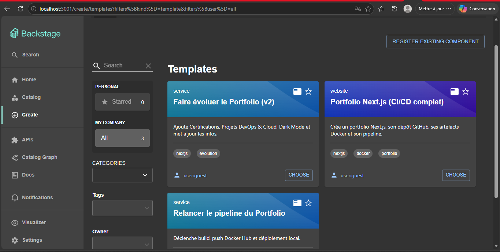

Le template s'exécute sans intervention manuelle : génération du projet, ajout du pipeline, création du dépôt GitHub, enregistrement dans le Catalog. Les liens *Dépôt GitHub*, *Ouvrir dans le Catalog*, *Application locale* et *Statut du build* sont affichés.

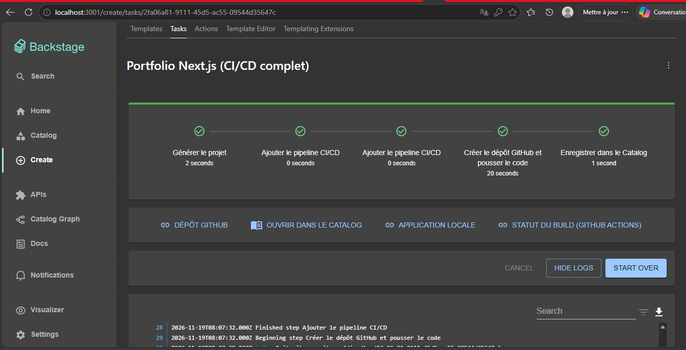

### Catalog et statut du build dans Backstage

Le composant `portfolio-nextjs` est dans le Catalog. L'onglet GitHub Actions affiche les runs du dépôt.

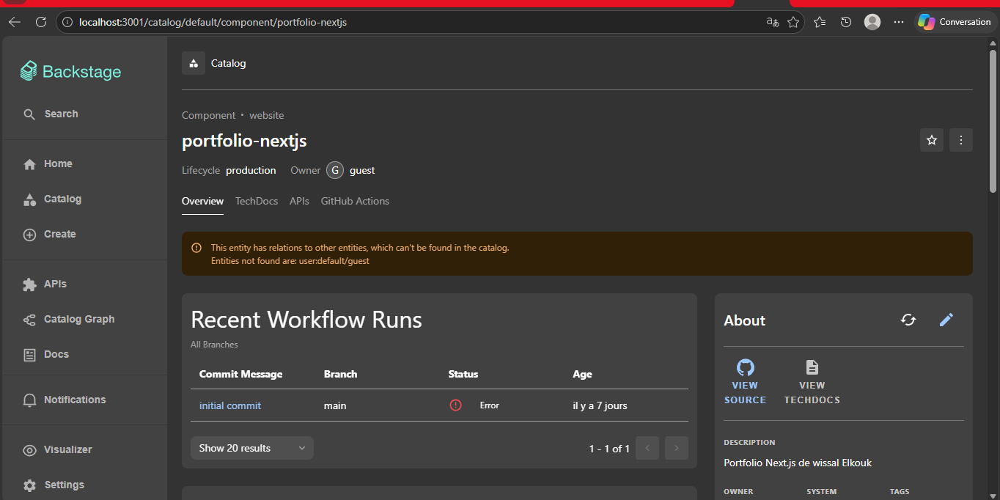

Les secrets Docker Hub sont posés dans le dépôt généré par l'action `publish:github`.

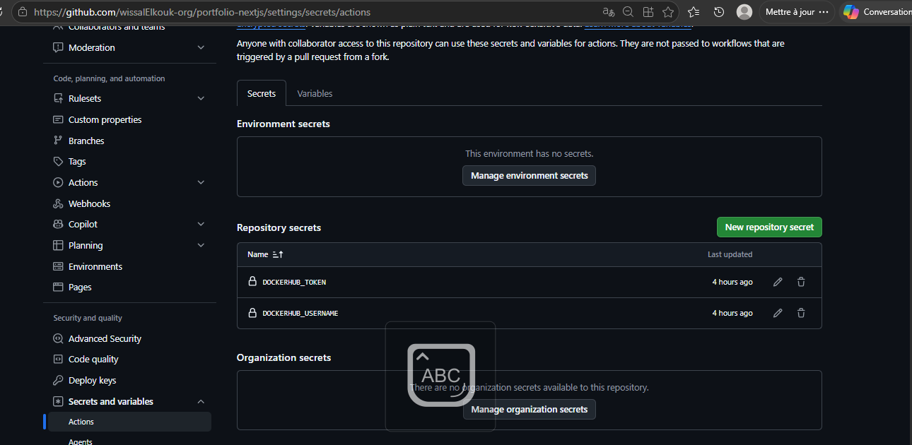

### Étapes 4 et 5 : build, version et publication sur Docker Hub

Run du dépôt généré : `build-and-push` puis `deploy-local` sont verts.

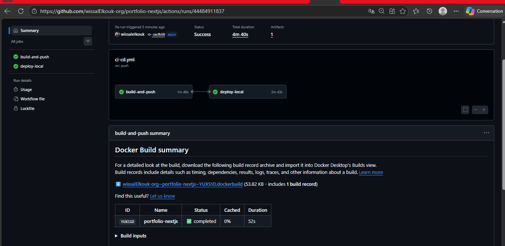

L'image est publiée sur Docker Hub.

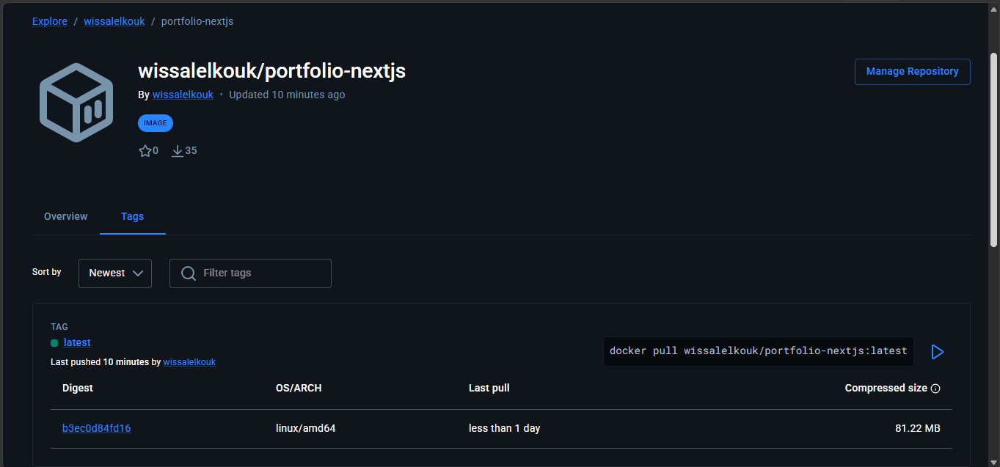

### Étape 6 : déploiement local automatisé

Le runner self-hosted est *Idle* avec le label `local`.

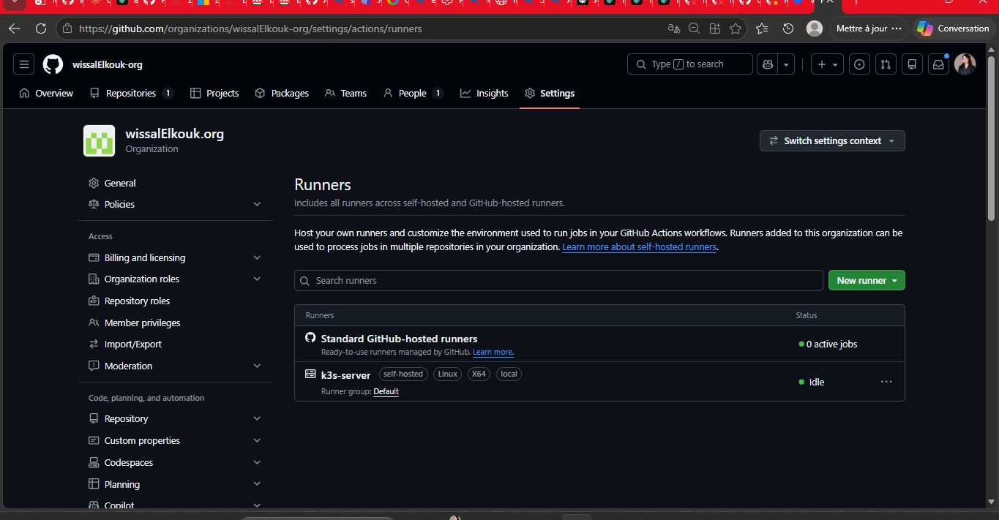

Le conteneur est sain et le contrôle de santé répond `{"status":"ok"}`.

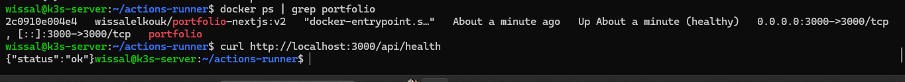

Portfolio de base, avant l'évolution.

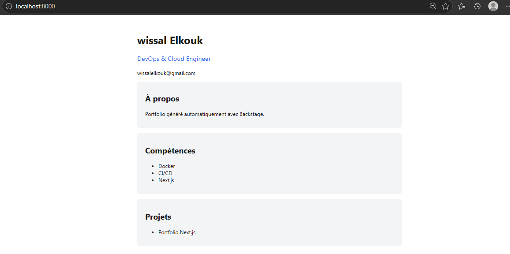

### Étape 7 : évolution du portfolio depuis Backstage

Formulaire du template *Faire évoluer le Portfolio (v2)*.

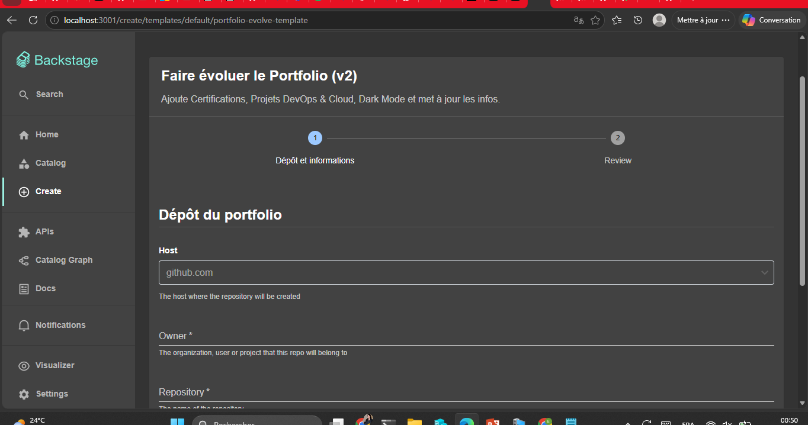

Les deux étapes passent au vert et une Pull Request est ouverte.

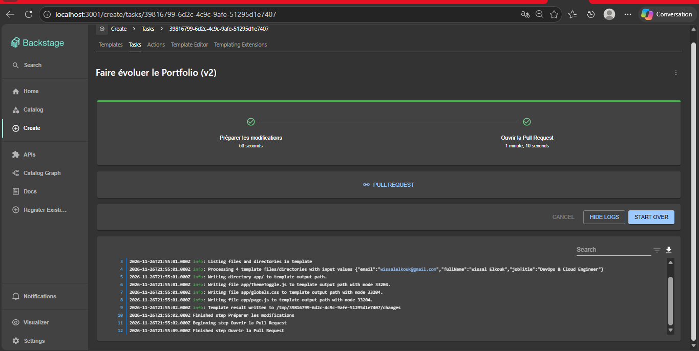

Le merge de la Pull Request déclenche automatiquement le pipeline : build, nouvelle image, déploiement et contrôle de santé.

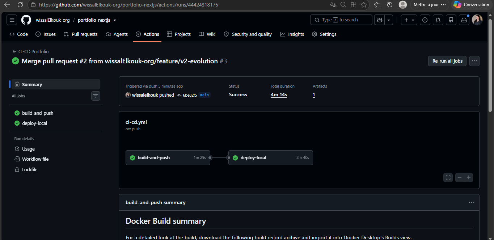

Le conteneur est remplacé par la nouvelle version.

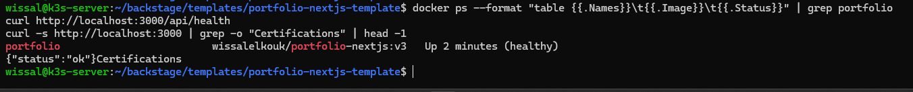

### Résultat final

Mode sombre, nom, titre et email mis à jour.

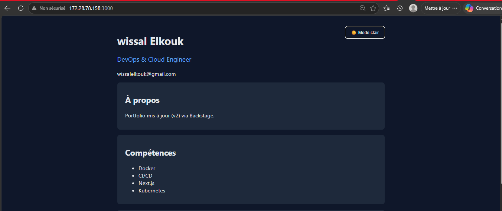

Sections **Certifications** et **Projets DevOps & Cloud**.

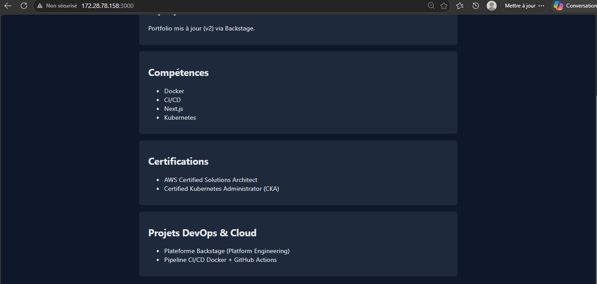

### Relance sans modification de code

Le template *Relancer le pipeline du Portfolio* déclenche le workflow par `workflow_dispatch` (action `github:actions:dispatch`). L'étape passe au vert et le lien *Voir les runs* est affiché.

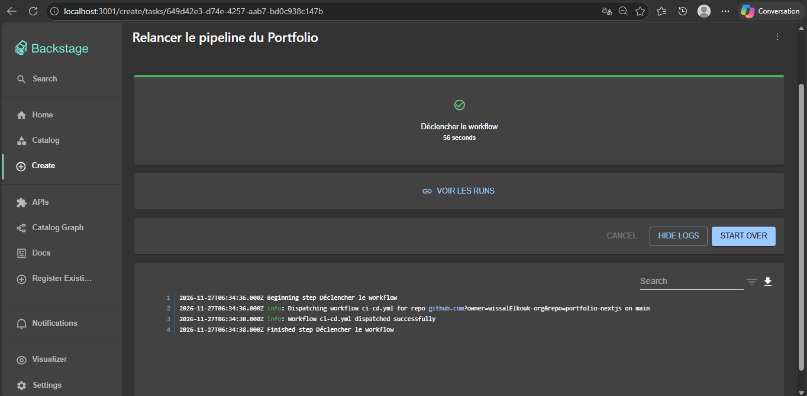

Le run #4 est déclenché manuellement depuis Backstage : `build-and-push` puis `deploy-local` sont verts, sans aucune commande Git, Docker ou Docker Compose saisie par le développeur.

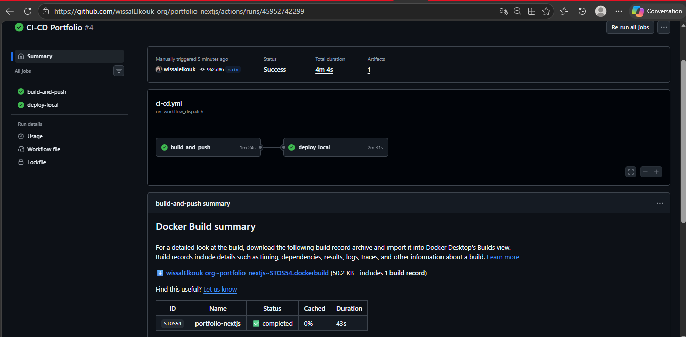

### Résumé de la procédure

1. **Création** : Create → *Portfolio Next.js (CI/CD complet)*, Owner = organisation, Repository = `portfolio-nextjs`.
2. **Premier pipeline** : GitHub → Actions, run `v1`.
3. **Vérification** :
   ```bash
   docker ps --format "table {{.Names}}\t{{.Image}}\t{{.Status}}" | grep portfolio
   curl http://localhost:3000/api/health      # {"status":"ok"}
   ```
4. **Évolution** : Create → *Faire évoluer le Portfolio (v2)*, puis merge de la Pull Request.
5. **Relivraison automatique** : nouveau run, nouvelle image, conteneur remplacé, contrôle de santé.
6. **Relance sans modification** : Create → *Relancer le pipeline du Portfolio*.

Les commandes `docker ps` et `curl` servent uniquement à constater le résultat.

## 10. Livrables

| Livrable | Emplacement |
|---|---|
| Template Backstage | `templates/` de ce dépôt |
| Dépôt Git généré | `https://github.com/<ORGANISATION>/portfolio-nextjs` |
| Application Next.js | `app/` du dépôt généré |
| Dockerfile, docker-compose.yml | racine du dépôt généré |
| Image Docker Hub | `https://hub.docker.com/r/<user>/portfolio-nextjs` (tags `v1`, `v2`, `v3`, `latest`) |
| Documentation technique | ce fichier |
| Démonstration | captures et enregistrement du workflow |

## 11. Difficultés rencontrées et solutions

| Problème | Cause | Solution |
|---|---|---|
| `create-app` refuse Node 22 | Version 0.9.x exigeant Node 24.15+ | Installer Node 24 avec nvm |
| `onCancel handler was attached after the promise settled` | Incompatibilité Yarn 4.13.0 et Node 24 | Utiliser Yarn 4.9.2 |
| Corepack ne télécharge pas Yarn (`ETIMEDOUT` vers `repo.yarnpkg.com`) | Domaine filtré par le réseau | Récupérer Yarn depuis le registre npm : `npm pack @yarnpkg/cli-dist@4.9.2`, copier `bin/yarn.js` dans `.yarn/releases/yarn-4.9.2.cjs`, mettre à jour `yarnPath`, désactiver Corepack |
| `Unrecognized ... npmMinimalAgeGate` | Option propre à Yarn 4.13 dans `.yarnrc.yml` | Supprimer `npmMinimalAgeGate` et `npmPreapprovedPackages` |
| `package.json` invalide (virgule finale) | Suppression de `packageManager` en dernière ligne | Retirer la virgule en trop |
| `got empty-string, wanted string` au démarrage | `GITHUB_TOKEN` absent du terminal | Exporter la variable dans le terminal qui lance `yarn start` |
| `Bad credentials` | Token invalide ou révoqué | Générer un nouveau token (`repo`, `workflow`) |
| `crypto.randomUUID is not a function`, `Failed to fetch` | Accès en HTTP par adresse IP | Utiliser `localhost` (tunnel SSH si besoin) |
| Catalogue vide, redémarrages en boucle | SQLite en mémoire, plusieurs instances (`EADDRINUSE`), fichiers modifiés | Une seule instance, ne rien modifier pendant l'utilisation |
| `ci-cd.yml` généré avec `username:` et `password:` vides | Rendu Nunjucks des expressions `${{ }}` | Copier le workflow avec `fetch:plain` (hors `skeleton/`) |
| `catalog:register` en `400 Bad Request` | Utilisation de `repoContentsUrl` | Utiliser `catalogInfoUrl` vers le fichier `catalog-info.yaml` |
| Pull Request bloquée (« Review required ») | Protection de la branche `main` | Désactiver la règle pour la durée du TP |
| `deploy-local` en attente | Runner sans label `local`, rattaché au mauvais compte | Réenregistrer le runner sur l'organisation avec `--labels local` |
| Port 3000 occupé | Conteneur Grafana existant | Arrêter ce conteneur avant la démonstration |
| Téléchargement du runner interrompu | Connexion lente | `curl -C -` avec reprise automatique |

## 12. Sécurité

- Aucun token dans le dépôt : `app-config.local.yaml` est ignoré par Git et référence `${GITHUB_TOKEN}`.
- Les secrets Docker Hub sont stockés comme *secrets GitHub Actions* du dépôt généré.
- Un token exposé doit être révoqué immédiatement et remplacé.
- Le jeton d'enregistrement du runner est à usage unique et expire rapidement.
- Un runner self-hosted exécute du code du dépôt sur la machine hôte : à réserver à des dépôts de confiance.

## 13. Pistes d'amélioration

- Base PostgreSQL pour conserver le catalogue entre les redémarrages.
- Authentification GitHub OAuth à la place de l'accès invité.
- Plugin GitHub Actions dans l'interface (onglet CI/CD) via le nouveau système de frontend.
- Déploiement sur Kubernetes (k3s) à la place de Docker Compose.
- Analyse de sécurité de l'image (Trivy) dans le pipeline.
### Points de vigilance supplémentaires

| Problème | Cause | Solution |
|---|---|---|
| `unauthorized: incorrect username or password` puis `malformed HTTP Authorization header` à la connexion Docker Hub | Identifiant et token saisis dans les mauvais champs du formulaire (utilisateur de 36 caractères, token de 5) | Réécrire `DOCKERHUB_USERNAME` et `DOCKERHUB_TOKEN`, contraindre le champ utilisateur du template, nettoyer les valeurs dans le workflow |
| Pull Request bloquée (« Review required ») | `publish:github` protège la branche `main` par défaut | Supprimer la règle ou ajouter `protectDefaultBranch: false` à l'étape `publish` |
| `redirect_uri is not associated with this application` | URL de rappel de l'OAuth App incorrecte | `http://localhost:7007/api/auth/github/handler/frame` |
| Composant absent du Catalog après redémarrage | Catalogue SQLite en mémoire | Déclarer le `catalog-info.yaml` dans `catalog.locations` |
| `IPC request 'DevDataStore.load' timed out` | VM trop lente (RAM insuffisante) | Libérer la mémoire, relancer une seule instance |
| Application inaccessible depuis le PC (`TIMED_OUT`) | Port 3000 filtré par le réseau | Tunnel SSH : `ssh -L 8000:localhost:3000 <utilisateur>@<ip-vm>` |


---

## Signature

Travail réalisé dans le cadre de l'activité pratique *Platform Engineering avec Backstage*, encadrée par **Wahid Hamdi**.

**Étudiante : Wissal Elkouk**

Date : ____ / ____ / 2026          Signature : ______________________
